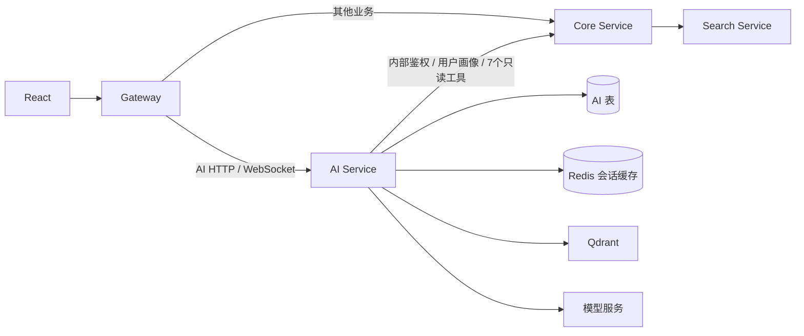

# AI 服务抽取（2026-10-26）

本批完成代码、独立打包和相关验证，尚未部署到服务器。首次上线必须协调更新核心、AI 服务与网关，不能只替换 pms.jar。

## 运行边界

- `services/pms-ai-service`：独立 Spring Boot / Spring Cloud 应用，服务名 `pms-ai-service`，默认 loopback 8281。接管原有 AI HTTP、知识库管理、WebSocket、Agent、模型调用、短长期记忆、会话、转人工和 RAG。
- 仅此服务持有 `ai_chat_session`、`ai_chat_message`、`ai_user_memory`、`ai_human_transfer`、`ai_knowledge_base` 的 Mapper，以及 Qdrant 和模型客户端。
- `contracts/ai-contracts`：保留原 DTO 包名以兼容 HTTP 和已有缓存类型；包含工具协议及用户画像投影，不包含业务实体、Mapper 或 LangChain4j。
- `components/service-runtime`：实际移入共享的响应、异常、用户上下文、Redis 序列化、限流及提交后缓存处理等 servlet 基础设施。核心与 AI 分别依赖它，AI 不依赖核心应用 JAR。Redis 类型别名和 Lua 资源也随组件迁移，未清空或改写历史缓存。
- 原核心应用移除 AI 实现及 LangChain4j / ONNX 依赖；AI 的业务测试随实现一起迁入新服务。核心仍通过公共 DTO 契约保持缓存兼容。

## 跨服务查询与身份

原 AI 直接查询用户、宠物、活动、日记及公告表。现在七个查询执行器回归各自的业务模块，模型服务仅持有其参数说明和远程适配器。`CoreQueryTool` 是窄查询端口，`BaseTool` 增加模型侧描述与参数 schema，避免把模型依赖带入核心。

核心提供 `/internal/ai/v1/authenticate`、`/internal/ai/v1/tools/{name}`、`/internal/ai/v1/profile/{actor}`。接口默认关闭，开启后需要至少32字节独立服务凭据，使用恒定时间比较；网关不公开该命名空间。只有该内部前缀绕过原 MVC 用户拦截器，内部 Controller 自行校验服务身份，普通公开接口不受影响。

AI 对每个公开请求调用核心 `UserSessions.authenticate`，获取当前账号状态和角色。因此已退出、已换密码、已禁用的账户仍会失效；不信任客户端的用户 ID、角色或内部请求头。WebSocket 连接及每条消息继续重新校验登录。核心工具调用显式传入经过认证的 actor，模型参数中的 `userId` 不参与身份选择；核心再次检查账号可用性。

查询通过 Spring Cloud LoadBalancer 发现核心实例。连接超时2秒、读超时5秒，不进行写入重试；依赖不可用返回失败，不用空结果冒充成功。模型请求与响应正文日志关闭，避免长期记忆写入模型客户端日志。

## 路径与数据兼容

- `/pet-system/ai/**` 与 `/pet-system/admin/ai/**` 改由网关转发到 AI。
- `/pet-system/ai/ws` 使用独立 `lb:ws://pms-ai-service` 路由；普通消息 WebSocket 仍归核心。
- 路径、响应信封、业务 DTO 字段、会话 ID、记忆清理和转人工流程保持兼容；前端无需改动。
- 本批无 DDL、数据回填或搬库。现有同一个 MySQL 实例可继续使用，但 AI 进程只访问 AI 表；生产应分配仅有这五张表权限的专用数据库账号。物理独立库属于后续部署迁移，不在本批宣称已完成。
- 会话 Redis key 和持久化类型保持原样；服务代码搬迁保留业务 Java 包名。AI 现有逐会话并发控制仍保留，不宣称已完成多实例跨进程互斥，因此首次部署采用一个 AI 实例。

## 配置与首次发布

AI 环境模板为 `ops/systemd/ai.env.example`，systemd 模板为 `ops/systemd/pms-ai.service`。敏感值保存在 `/opt/pms/ai/ai.env`（权限600），模型 key、AI库凭据、Redis 凭据不得提交仓库。模型参数可经外部 YAML 提供以沿用当前配置，尤其保留 `ai.agent.enable-long-term-memory`、记忆窗口、RAG及模型超时等当前取值。知识库启动全量同步默认关闭，避免新进程启动时重复写共享向量库。

核心配置 `PMS_AI_CORE_ENABLED=true` 与相同的 `PMS_AI_CORE_SERVICE_TOKEN`；Cloud profile 提供显式环境绑定。AI 和核心的服务凭据必须一致；它与用户 JWT 密钥分别管理。AI 使用 Eureka / Config 的现有地址，所有服务的注册地址应与实际部署网络匹配。

首次上线顺序：

1. 备份核心 JAR、网关 JAR、服务单元、外部配置和发布指针；备份包含密钥的配置权限设为600。
2. 配置 AI 专用数据库账号、模型和 Redis 参数，以及双方的内部服务凭据。沿用旧的 AI 表、模型设置和缓存，不删除数据。
3. 在短维护窗口更新核心、开启内部查询端点；启动 AI，确认注册到 Eureka、数据库与 Redis 健康、现有管理员登录令牌可读取 AI 会话、普通用户不能管理知识库。
4. 验证用户画像和七个业务工具后，发布新网关切换 AI HTTP / WS 路由；确认聊天、历史、长期记忆、转人工和WebSocket。
5. 任一步失败，应一起恢复核心和网关，再停止新 AI 进程；表结构没有变化，不清数据回滚。

旧 `promote_backend.py` / Jenkins 单 JAR 发布链路增加前置检查：如果核心已经抽取 AI，却未检测到运行中的 `pms-ai` 与新网关路由，则在停止或替换服务前拒绝发布，避免只升级核心导致 AI 入口消失。首次协调上线完成后，核心普通更新可以继续使用该链路；AI 和网关使用各自构建产物更新。模板未自动安装、未执行上述线上步骤。

本地 `scripts/local/cloud_stack.py` 已加入 AI 服务，复用现有隧道和本地私有配置，生成单独内部服务凭据。该命令使用配置中的共享基础设施，执行前仍需正确本地配置；本批未启动该整套共享环境。

## 验证范围

- 独立应用上下文真实启动，注册 AI Mapper、8个工具、原 HTTP 与 WebSocket 配置；测试中替换模型与内部认证客户端，不调用付费模型。
- 原有会话/反馈/转人工/事务回滚和归属测试随服务迁移；MySQL 测试使用授权的本机 `pet_system_test`，结束后清理自有测试记录。
- 新增内部身份校验、禁用用户、伪造用户参数隔离、远程 HTTP 协议及503故障测试。
- 网关测试使用不同真实 HTTP 下游验证 AI 和核心路由；单独断言AI WebSocket目的服务及匹配顺序，原WebSocket消息处理测试继续运行。尚未做上线后的真实跨进程WebSocket验收。
- 共享 Redis 序列化兼容、提交后缓存、策略注册、模块边界和核心无AI类/模型依赖检查。
- `python scripts/architecture/check_ai_service.py` 覆盖源码与构建后的核心 JAR；原跨模块内部引用由181项降至154项，没有扩大基线许可。

最终验证：67项相关Java测试（网关7、AI服务33、核心与共享兼容27）及4项Python发布脚本测试全部通过；所有Maven模块打包成功。测试未调用真实付费模型、未部署线上进程。
