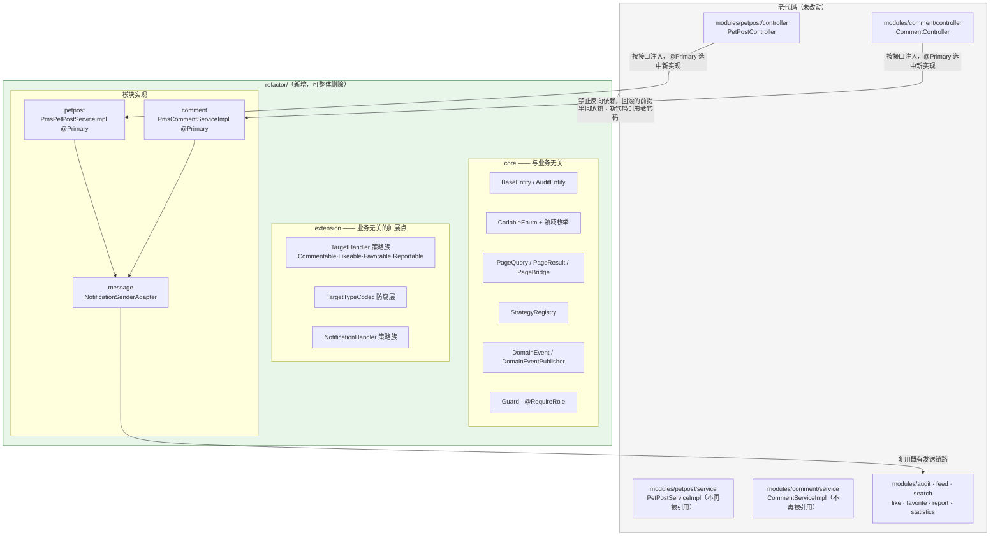
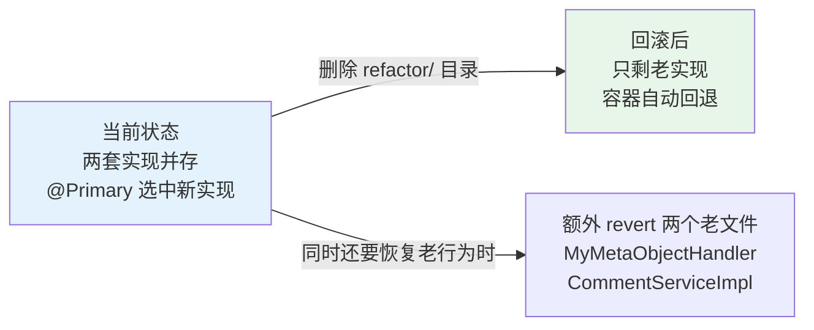
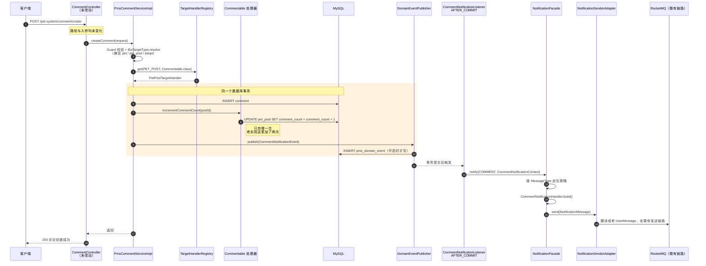
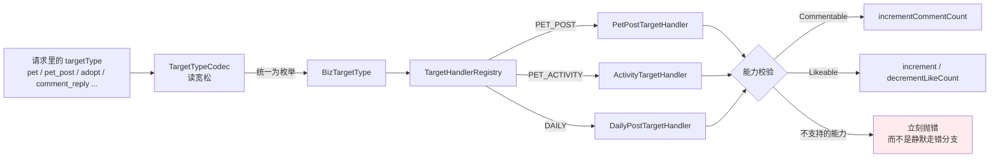

# 重构后架构总览

配套文档：[ADR 索引](../adr/README.md)

## 一、包边界与回滚

全部重构代码在一个根包下，删除它即完成回滚。

**关键约束**：箭头只能从 `refactor/` 指向老代码，反向依赖被禁止 ——
这正是"删掉 `refactor/` 后老代码仍能独立编译"能成立的原因。

## 二、回滚示意

回滚**不需要改任何配置**：`@Primary` 标记的新实现一消失，
`PetPostService` / `CommentService` 各自只剩一个候选 bean，容器自动注入老实现。

## 三、评论创建的完整链路

这条链路串起了本次重构的大部分机制：策略定位、事务边界、事件、通知渲染、适配器。

**两处关键设计在图中可见**：

- 橙色区块内是**同一事务**：业务写与发件箱写入同生共死，不会出现
  "业务回滚了但消息已经发出去"；
- 通知在**事务提交后**才走 MQ（`AFTER_COMMIT` 监听器），
  这是相对老实现（事务内直接发 MQ）的核心修正。

## 四、多态互动的消歧

原本散落在 6 处以上的类型分支，现在收敛成一次注册表查找。

三套历史字面量（`pet_post` / `pet` / `adopt`）在入口被归一，
新代码只面对枚举；写入时再由防腐层按目标表还原成该表认得的方言。

## 五、当前状态与未完成项

| 项 | 状态 |
|---|---|
| `core` 基础层 | 完成，有单测 |
| `extension` 策略族与防腐层 | 完成，有单测 |
| petpost 模块重写 | 完成（15 个方法），有转换器单测 |
| comment 模块重写 | 完成（2 个方法 + 评论树） |
| notice 模块重写 | **未开始** |
| 其余 20 个模块 | **未开始** |
| 物理表切换 | **未进行**（见 [ADR 0007](../adr/0007-table-cutover-strategy.md)） |
| 运行时验证 | **未进行** —— 本机无法启动应用（依赖 MySQL/Redis/Qdrant/RocketMQ） |

验证现状：113 个单元测试全部通过，覆盖枚举与方言解析、分页桥接、策略注册表、
字段填充、通知文案、DTO 与评论树映射。**集成行为、以及"`@Primary` 在真实容器里
确实选中了新实现"，没有实跑验证过。**
