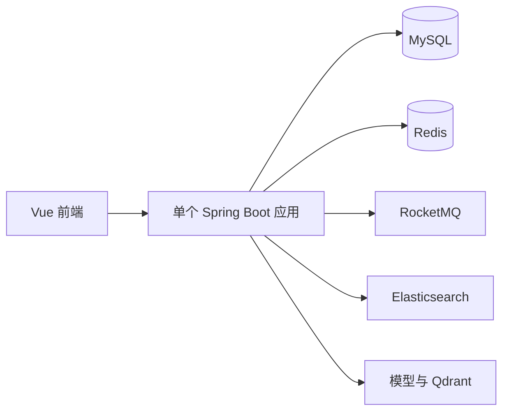
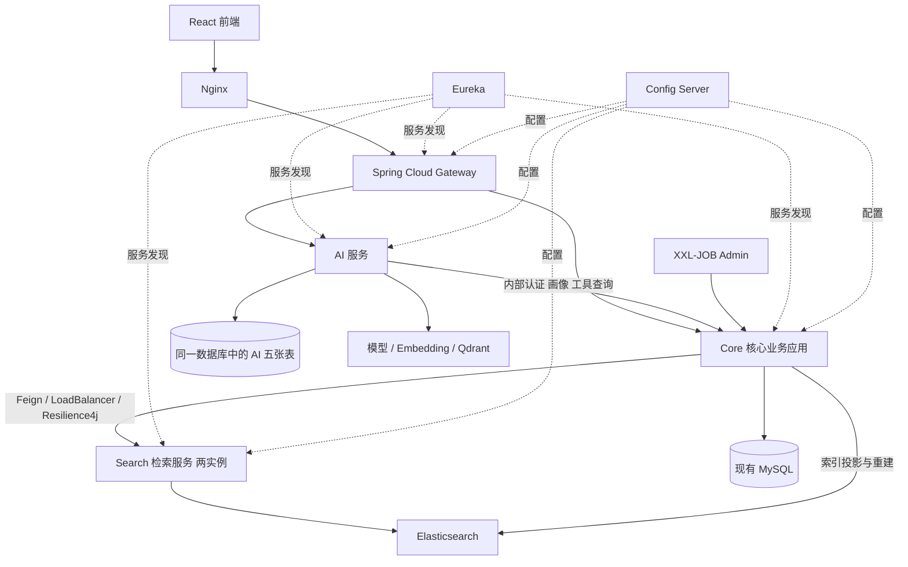

# PMS 大规模重构前后对比报告

> 整理日期：2026-10-27。代码核对终点：`b9a37c2`。旧实现对照基线：`ad0980e`。
>
> 本文解释这次改造的实际变化：原来如何实现、现在如何实现、为什么调整、用户能观察到什么，以及哪些设计尚未完成。代码状态、部署记录和预留设计分别说明，不把目录中出现某个类或 SQL 文件视为功能已经上线。

## 阅读导航

- [一、范围、结论与证据口径](#scope)
- [二、迁移过程与兼容边界](#migration)
- [三、架构、工程和服务拆分](#architecture)
- [四、数据模型与物理数据库](#models)
- [五、设计模式和公共抽象](#patterns)
- [六、事务、并发与缓存](#consistency)
- [七、内容、互动与社区业务](#content)
- [八、审核、举报与账号治理](#governance)
- [九、活动和我的报名](#activities)
- [十、通知和私信](#communication)
- [十一、推荐、统计与定时任务](#background)
- [十二、搜索查询、索引与独立服务](#search)
- [十三、AI 会话与独立服务](#ai)
- [十四、React 前端、交互与性能](#frontend)
- [十五、部署、验证与回滚](#delivery)
- [十六、仍有的边界与后续方向](#limits)
- [十七、关键提交和专题文档索引](#evidence)

<a id="scope"></a>
## 一、范围、结论与证据口径

### 1.1 这次重构到底做了什么

起点是一个 Spring Boot 单体应用：业务模块按目录划分，但长 Service 同时承担数据库写入、状态判断、DTO 装配、Redis 操作、消息投递和搜索同步。前端是 Vue。项目已经具备较完整功能，主要问题是规则散落、修改影响面较大、部分一致性依赖执行顺序，并发和异常分支缺少验证。

最终形成了一个以核心业务应用为中心，搜索检索与 AI 独立运行，配套 Spring Cloud 网关、注册中心、配置中心的 Maven 多模块工程。核心业务按领域重新组织，重要写流程补上事务、条件更新和锁顺序，副作用逐步移到提交后执行；前端换为 React，并补齐原型、私信可靠性和报名查询。

**这并不是所有业务都拆成了微服务，也不是把所有旧表重新建了一遍。** 核心事务仍保留在 Core 中，共享实体、Mapper、DTO 和必要基础设施继续使用；独立服务的职责和剩余耦合在后文明确列出。

| 维度 | 原来 | 现在 | 直接变化 |
|---|---|---|---|
| 工程 | 一个后端 Maven 应用 | 根聚合工程，10 个子模块 | 可分别构建运行 Core、Search、AI 和治理组件 |
| 业务组织 | `modules`、`common`、`AI` 混合分层 | 按账号、内容、社区、通信、治理等领域组织 | 业务入口、应用逻辑、持久化及平台能力更容易定位 |
| 写流程 | Service 中顺序执行多种动作 | 本地事务保护主数据，条件更新/锁保护竞争，提交后执行副作用 | 回滚不再直接伴随已发送的通知和索引更新 |
| 多目标扩展 | 评论、点赞、举报等多处类型分支 | 能力接口与策略注册表 | 新目标类型有明确扩展入口 |
| 审核 | 多入口分别更新状态 | 统一命令、当前待审核记录、锁和条件更新 | 编辑后重审、重复操作与并发处理更可控 |
| 缓存 | 写后散落的缓存操作，个别链路遗漏 | 显式依赖失效与提交后执行 | 页面操作后的旧数据问题得到针对性修复 |
| 私信 | 页码历史、直接推送为主 | 游标历史、向上加载、重连补消息、稳定发送键 | 支持连续聊天体验和失败重试 |
| 定时任务 | 本地调度、延迟队列和数据库扫描并存 | XXL-JOB 集中触发，数据库保留业务任务账本 | 触发日志和重试集中，业务幂等仍由应用负责 |
| 搜索 | 同一进程承担检索、回表、索引维护 | 独立检索服务，Core 保留权威数据与索引投影 | ES 候选与数据库实时可见性分离 |
| AI | 与 Core 同进程，工具直接访问业务 Mapper | 独立 AI 服务，核心查询经内部接口 | 模型运行时和业务写事务解耦 |
| 前端 | Vue 页面 | React 原型实现 | 页面布局、会话弹窗、路由切换和加载方式同步调整 |
| 维护 | 命名、排版、转换规则不一 | 模块边界、显式转换、统一格式化入口 | 后续改动更容易审查和复现 |

### 1.2 对照基线与数量

旧代码基线选用 `ad0980e`，即大规模重构前最后一批功能代码；该提交已经包含 AI 长期记忆管理。不是拿一个更早、功能更少的版本来夸大变化。`2094f3d` 是公共模型与策略基础层的重要起点。

| Git 跟踪源码口径 | 基线 | 本次整理终点 |
|---|---:|---:|
| 主代码 Java 文件 | 343 | 580 |
| 测试 Java 文件 | 1 | 102 |
| Java 总文件 | 344 | 682 |

文件增加来自职责拆分、服务独立与验证补充，不代表代码越多越好，也不能推导测试覆盖率。旧代码集中清理阶段移除了 73 个失去用途的主代码文件。模块依赖清单记录的跨模块内部引用条目从 181 降到 154，说明耦合减少，但没有消失。

### 1.3 哪些能力原来就有

旧项目已经有 JWT、BCrypt、MyBatis-Plus、Redis/Redisson、RocketMQ、Elasticsearch、限流/幂等/熔断组件、审核策略工厂、Spring 事件、AI ReAct、工具注册表、DeepSeek、BGE、Qdrant 和短长期记忆。部分列表查询也已经批量加载作者，不能笼统说旧版全部是 N+1 查询。

本次的价值是将这些能力放到更合理的边界内，修复规则和一致性问题，增加可验证的行为；并非首次引入上述所有技术。

<a id="migration"></a>
## 二、迁移过程与兼容边界

### 2.1 从保留旧代码到最终清理

最初约束是保留旧业务文件，用同一个启动入口接管实现。因此初期把新实现放在 `refactor/` 下，通过 Spring Bean 选择切换。为兼容旧代码注入具体实现类，过渡期间还出现过继承旧实现的门面。

随后范围逐步扩大：业务迁移完成、解除具体类继承、统一接口，再清理无引用旧 Bean、旧调度和重复设施，最后整理为当前领域目录。当前不能再用“删掉新目录即可回滚”描述系统；这是早期迁移策略，不是最终回滚方案。

| 阶段 | 当时的目的 | 后来如何收敛 |
|---|---|---|
| 新旧并存 | 在不一次性替换所有入口的情况下验证新业务 | 按模块切换并补等价性与并发验证 |
| 兼容门面 | 保持旧注入点可用 | 剩余 12 个继承旧实现的包装改成接口边界 |
| 生命周期收敛 | 防止旧调度、初始化和消费者继续执行 | 显式接管生命周期，再移除失效实现 |
| 物理清理 | 消除已经不参与运行的代码 | 清理 73 个旧文件，不再长期维护双套业务 |
| 模块化 | 为服务拆分建立边界 | 组织 Core、组件、契约、独立服务 |

`@Primary` 只能影响注入选择，不能自动停止旧 Bean 的 `@PostConstruct`、定时任务或 MQ 消费者。因此“新 Service 生效”不等于“旧逻辑完全停止”。生命周期清理是这次迁移的重要组成部分。

### 2.2 保持了什么，改变了什么

- 尽量保留原 HTTP 请求路径，允许新增接口。
- 原 DTO 不因重构而一律删除；通过转换、兼容字段或新 DTO 适配。
- 入参和返回结构不是全部冻结。私信游标接口明确改变了分页契约，前端同步迁移。
- 共享模型、Mapper 和基础设施继续复用；不是为了换名字重建所有表。
- 已完成领养/救助和已结束活动关闭编辑重新审核流程，属于明确的业务规则变化。
- 旧 Vue 工程在 React 接管后移除，可从 Git 历史恢复。

典型 API 变化如下：

| 场景 | 路径处理 | 契约或语义变化 |
|---|---|---|
| 宠物/活动列表与详情 | 沿用业务路径 | 转换层保留兼容字段，补充必要展示字段 |
| 审核操作 | 沿用公开入口 | 统一审核命令，针对当前待审核记录处理 |
| 私信历史 | 保留会话消息入口 | 页码转为 `beforeId` / `afterId`、`records`、`nextCursor`、`hasMore` |
| 私信发送 | 保留发送入口 | 新增可选 `clientMessageId`，支持幂等重试 |
| 我的报名 | 新增接口 | `/pet-system/activity/my-signups` 及 `/summary` |
| AI | 保留公开 `/pet-system/ai/**` | 网关将流量转到独立服务；核心数据走内部受保护协议 |
| 用户数据 | 维持主要字段兼容 | 密码字段不返回哈希，身份与可见性由服务端决定 |

<a id="architecture"></a>
## 三、架构、工程和服务拆分

### 3.1 重构前



目录上有业务模块，但核心写逻辑、搜索检索、AI 推理、后台任务都在同一应用生命周期中。一个模块经常直接拿另一个模块的 Mapper，目录边界不等于运行边界。

### 3.2 重构后



Search 只独立检索，Core 仍负责业务数据回表和搜索投影写入。AI 的七个核心业务查询工具由 Core 执行，AI 保留工具描述、模型编排和知识检索。这样避免独立服务继续偷偷依赖 Core Mapper。

当前有 Core、Search、AI 三类业务应用，Gateway、Eureka、Config 三类治理应用；Search 运行两个实例，对应七个 JVM 服务进程。它们仍部署在同一服务器，不构成跨机器高可用集群。

### 3.3 工程目录与职责

```text
PMS/
├── apps/pms-app/                 核心业务应用
├── services/
│   ├── pms-registry/             Eureka
│   ├── pms-config-server/        配置中心
│   ├── pms-gateway/              统一入口
│   ├── pms-search-service/       独立搜索检索
│   └── pms-ai-service/           独立 AI
├── contracts/
│   ├── search-contracts/         搜索调用协议
│   └── ai-contracts/             AI 与 Core 调用协议
├── components/
│   ├── service-runtime/          可共享的运行基础能力
│   └── search-engine/            搜索引擎公共能力
├── PMS-react/                    当前前端
├── database/                     schema / legacy / manual / seeds
├── scripts/                      格式化、检查和交付辅助
└── docs/                         架构、决策、验证和部署记录
```

Core 内部按以下业务边界组织：

| 领域 | 包含内容 | 当前保留在一起的原因 |
|---|---|---|
| identity | 用户、账号、管理、限制 | 身份和限制状态被核心操作频繁使用 |
| content | 领养/救助、日常 | 发布、审核、可见性和互动投影联系紧密 |
| activity | 活动、报名、签到 | 人数、报名状态与时间规则需要本地事务 |
| community | 评论、点赞、关注、Feed | 互动关系和计数、可见性存在共享事务 |
| communication | 通知、私信、公告 | 各自保留业务模型，复用传输能力 |
| governance | 审核、举报 | 处理决定需要原子更新目标业务状态 |
| analytics | 统计 | 汇总权威业务事实 |
| scheduling | 到期任务 | 集中承载时间驱动业务动作 |
| search | 搜索回表、投影、索引同步 | 权威内容仍在 Core |

这些是模块边界，不是每个目录一个远程服务。当前没有引入跨服务业务事务或 Saga，也没有把每个领域拆成独立数据库。

### 3.4 技术版本的真实变化

| 项目 | 之前 | 当前 |
|---|---|---|
| Java | 17 | 17 |
| Spring Boot | 3.1.5 | 3.5.16 |
| Spring Cloud | 无当前治理组合 | 2025.0.3 |
| MyBatis-Plus | 3.5.3.1 | 3.5.17 |
| Elasticsearch | 已有搜索能力 | 客户端 8.7.1，兼容现有 7.17 服务端 |
| LangChain4j | 已有 1.19.0 体系 | 随 AI 服务独立运行 |

客户端升级不表示线上 Elasticsearch 服务端升级。详细边界见[服务拆分说明](../architecture/spring-cloud.md)和[模块边界](../architecture/module-boundaries.md)。

<a id="models"></a>
## 四、数据模型与物理数据库

### 4.1 原来的问题

旧模型层约有 31 个映射实体，没有统一实体基类；时间字段存在 `create_time` 与 `created_at` 等不同命名，填充策略不一。`status` 在用户、帖子、评论、公告中含义不同。多态关联里的 `target_type` 还存在 `pet`、`pet_post`、`activity`、`pet_activity` 等历史表达。

两份历史建表脚本存在漂移，不能只看某一份 SQL 注释推断线上真实字段和状态。分类虽有字典表，但推导和部分展示仍有硬编码。这里面有的通过本次业务契约得到约束，有的仍是下一阶段数据治理问题。

### 4.2 现在如何处理

| 层次 | 当前做法 | 没有做的事情 |
|---|---|---|
| 基础实体 | `BaseEntity` 提供 id、创建/更新时间 | 没有让全部旧实体立即继承 |
| 扩展审计实体 | `AuditEntity` 预留创建人、更新人、deleted、version | 没有给全部线上表补齐这些列 |
| 状态 | 各业务独立枚举，复用状态契约 | 没有把所有表状态压成同一套数字 |
| 目标类型 | Codec 读取历史别名，按具体上下文输出 | 没有一次性改写所有历史字符串 |
| 实体到响应 | 显式字段转换与白名单 | 没有把实体所有字段直接透传给客户端 |
| 分页 | PageQuery、PageResult、PageBridge 辅助 | 没有强制所有 API 改成同一个 JSON 结构 |
| 数据库 | 沿用主要旧表，按需要增量迁移 | 没有完成全量新表切换和自动版本化迁移 |

`AuditEntity` 中预留的 `@Version` 不代表全系统都启用了乐观锁。它的删除标记也不能等同于所有业务已统一采用 MyBatis-Plus 全局逻辑删除；回收站查询需要显式控制可见范围。

### 4.3 宠物帖子模型是一个具体例子

新的 `PmsPetPost` 让业务字段含义更清楚，但实际映射仍是旧 `pet_post`：

| 层次 | 品种 | 年龄 | 删除表示 |
|---|---|---|---|
| 原物理列 | `pet_type` | `pet_age` 自由文本 | `status=-1` |
| 新 Java 模型 | `petBreed` | `petAgeText` | 保留旧状态映射 |
| 兼容 API | `petType` | `petAge` | 按业务接口暴露 |
| 新表设计草案 | 更明确的品种字段 | 月龄等结构化方案 | 独立 deleted/version 方案 |

因此，这是“先改善代码模型与业务规则，保留物理表兼容”，不是已经把年龄统一成数字月龄。仓库存在 `pms_pet_post`、`core-v2.sql` 等设计文件，不等于所有 Mapper 和线上数据已切过去。

对应实现：[PmsPetPost](../../apps/pms-app/src/main/java/com/hongjie/pms/modules/content/petpost/infrastructure/persistence/entity/PmsPetPost.java)。

### 4.4 实际落地的重要数据库增量

私信增加了查询与幂等支持：

```sql
-- 示意：实际迁移文件及执行记录见私信部署文档。
INDEX idx_private_message_conversation_id (conversation_id, id)

client_message_id VARCHAR(64) CHARACTER SET ascii COLLATE ascii_bin NULL

UNIQUE KEY uk_private_message_sender_client (from_user_id, client_message_id)
```

第一个索引支持在指定会话内按 ID 范围向前/向后取消息；唯一键约束同一发送者的重试键。字段可空，兼容旧消息和未携带发送键的客户端，不需要给历史消息伪造请求键。

AI 独立部署新增了仅能访问 AI 五张表的数据库账号。这是权限边界变化；底层仍是同一物理数据库，不能说已经实现数据库实例隔离。

### 4.5 本次没有全面解决的数据问题

目前没有全量统一所有实体的时间字段，没有为全部关系补外键，没有迁移成完整 Flyway/Liquibase 版本体系，也没有统一修复所有历史计数和分类硬编码。后续若切新表，需要明确迁移、校验、双读或停机切换、回滚的完整方案，不能只改 `@TableName`。

<a id="patterns"></a>
## 五、设计模式和公共抽象

### 5.1 策略与注册表：把变化点收敛到目标能力

以前新增一种互动目标，可能同时修改评论、点赞、举报、通知中的多段分支。现在区分 Commentable、Likeable、Favorable、Reportable 等能力，由各自策略描述如何检查目标、更新计数和生成必要投影，注册表负责按类型查找。

注册时检查重复键，可以把部分配置错误提前到启动阶段。未知类型或不支持的能力明确拒绝，不让“任何实体都可以点赞/举报”成为隐式约定。

这沿用了旧审核工厂、旧 AI 工具注册表中已经有效的思想，扩展到更多业务。共享的是注册机制，不是让所有策略实现一个包含几十个方法的大接口。

### 5.2 转换器与读模型：复用字段规则，而非自动复制实体

旧代码在多个列表、详情、收藏中重复 builder。新代码通过显式转换器、Assembler 和批量装配统一规则：实体持久化、公共响应、当前用户互动状态分别处理。

没有全面引入 MapStruct 或 BeanUtils。显式映射的代价是需要维护字段，但可以审查敏感字段和兼容字段，不会因为实体新增字段就静默改变 API。

### 5.3 应用服务与命令：给事务一个清晰入口

活动被拆分为内容、参与、生命周期与查询职责；账号被拆分为认证、资料、会话、头像、管理和限制；审核/举报有统一命令入口。Controller 接收请求和身份，应用服务编排业务，持久化层负责明确 SQL。

没有给每个类机械增加接口，也没有用一个通用 CRUD 父类包办权限、缓存、状态机和所有事务。新增抽象以变化点和真实复用为依据。

### 5.4 事件、观察者和提交后副作用

旧 Service 经常在事务内发送通知、修改缓存或同步搜索。现在将部分副作用变成事件监听或提交后回调，使“事务回滚”不会继续执行正常成功路径的副作用。

但必须区分两层保证：

1. **已经落地**：业务提交后再触发相关缓存、消息和搜索动作；通知降级写入有独立事务边界。
2. **预留但未完成完整可靠链路**：Outbox 抽象与可选存储。配置默认不启用，尚不能据此宣称有持久化重放、投递确认或端到端恰好一次。

`DomainEventPublisher` 能选择 Outbox 存储，不代表系统已经拥有完整的后台投递器、消费幂等和故障补偿闭环。

### 5.5 服务抽取中的端口与适配

SearchBackend 将检索实现与核心查询分开；AI 工具协议将模型编排与核心业务查询分开。Feign、RestClient、ES 是适配方式，业务不应依赖对端内部 Mapper。

`contracts` 只承担协议共享，`components` 承担可复用技术实现，不把整个 Core 当成公共依赖包。更多取舍见[ADR 索引](../adr/README.md)。

<a id="consistency"></a>
## 六、事务、并发与缓存

### 6.1 写操作从“按顺序调用”变成“有约束的状态转换”

原先的常见流程是先读实体、Java 判断、再更新若干表。两个请求可能都读到旧状态，各自通过检查，造成重复处理或计数错误。现在重要流程采用行锁、当前读、条件更新和受影响行数检查。

```text
原来：读状态 -> 判断可执行 -> 写状态 -> 改计数 -> 发消息
现在：按约定顺序锁定 -> 校验当前状态 -> 条件写入并检查行数
      -> 同一事务维护关联数据 -> 提交 -> 触发外部副作用
```

报名中“仍有名额”、审核中“仍待处理”、举报中“仍未处理”、点赞取消中“本次确实删掉记录”，都成为写入条件的一部分。不是只在请求开始时检查一次。

### 6.2 锁顺序与事务边界

| 流程 | 主要顺序/边界 | 防止的问题 |
|---|---|---|
| 关注 | 用户行按 ID 顺序锁定 | 两个方向操作造成反向锁竞争 |
| 私信发送 | 用户顺序，再会话 | 会话创建、预览和未读并发不一致 |
| 活动 | 活动，再报名 | 报名、取消、签到争用状态 |
| 审核 | 目标内容，再当前待审记录 | 内容状态与审核记录分别成功 |
| 到期任务 | 业务行，再任务行 | 任务状态与业务动作分裂 |
| 统计 | 每日快照独立事务 | 一天失败删除或污染全部历史快照 |

锁会带来等待，并不意味着查询一定更快。热门用户、活动或会话仍可能形成热点；必须结合事务耗时、慢 SQL、连接池和锁等待数据分析。

### 6.3 缓存更新的变化

以前缓存删除散落在写方法末尾，容易只失效详情、漏掉列表，或在事务回滚前已经操作 Redis。部分带当前用户状态的 DTO 被共享缓存后，还会把别人的点赞/关注状态带给当前用户。

现在把内容变化影响的缓存依赖列清楚，相关失效安排在提交后。用户相关字段由当前请求计算，避免把共享内容缓存当成个性化最终响应。

| 场景 | 原问题 | 当前处理重点 |
|---|---|---|
| 点赞/取消 | 计数变了，详情/列表仍旧；页面整页刷新 | 写事务结束后更新相关缓存，前端局部应用结果 |
| 评论 | 重复累加；自己的评论可能未走通知分支导致漏副作用 | 计数单次维护，评论事件不依赖是否需要通知自己 |
| 编辑/审核/删除 | 多种内容投影同步不全 | 按内容变化失效列表、详情等依赖并触发索引同步 |
| 用户资料/隐私 | 缓存个人态或旧角色 | 当前身份与权限重新校验，公开投影按请求装配 |
| Feed | 收件箱冗余标题、作者资料变旧 | 展示时批量读取当前权威内容和用户数据 |

Redis 失败时业务可能已经提交，不能伪装成数据库回滚。提交后动作需要日志、重试或补偿；当前并不具备所有失败场景的持久化自动补偿。直接 SQL 改表也不自动触发应用事件，本次针对的是正常页面操作链路。

<a id="content"></a>
## 七、内容、互动与社区业务

### 7.1 领养与救助帖子

**原来**：发布、编辑、查询、收藏、权限与缓存大量集中在一个实现中，转换重复，更新容易携带旧快照字段，审核流程有多个状态更新入口。

**现在**：新的帖子模型与显式转换保留旧表和接口字段；写入按允许字段更新，计数、作者和审核状态由服务端管理；编辑后的真实变更走重新送审，新待审记录表示新一轮审核，旧审核结论保留。

**可观察变化**：编辑后能正常审核当前轮次；已完成领养/救助不允许再编辑重新送审。它不等于完成后所有互动操作都被禁用，评论、点赞等按各自规则处理。

公开列表和可见性在部分场景继续保留旧业务语义，不能只凭“公开内容”四个字推断一律只返回 status=1。具体条件由查询实现与专题验证约束。

### 7.2 评论

**原来**：`createComment` 的重复分支对宠物/活动评论重复累加；目标作者和通知逻辑混在分支里，回复跳转也有错误。

**现在**：通过目标能力定位评论对象，评论记录和计数在同一事务中维护一次；父评论/根评论关系规范化，作者信息批量装配。创建事件独立于通知接收者，即使评论自己的内容，缓存和索引也不会因为“不需要通知自己”而漏更新。

**限制**：当前公开 `deleteComment` 入口仍保留未调用业务删除的空实现，不能把本次描述成完整评论增删改查重写。举报对评论的治理也不代表所有历史计数修复已经完成。

### 7.3 点赞与收藏

**原来**：按目标类型 switch，计数、消息和缓存交错；取消路径慢，客户端还会触发明显加载反馈和重复刷新。

**现在**：点赞目标策略负责目标检查与计数，关系写入依赖唯一约束；取消时只有本次确实删掉关系才减计数，计数有下界保护。通知和缓存放到提交后，取消/给自己点赞不产生不必要通知。收藏保留适用业务范围，不强迫所有目标实现收藏。

前端只更新按钮和计数，不用整页刷新，也移除了按钮前的加载圆圈。操作中的重复触发仍可受控，并非取消所有并发保护。

点赞接口仍有“切换”语义。重复提交两个成功切换请求可能一赞一取消，不能把它等同于私信稳定请求键那样的幂等协议。返回计数是该操作观察到的快照，也不承诺全球并发下每个客户端永远显示同一瞬时值。

### 7.4 关注

**原来**：部分关系方向判断反了，关注/粉丝、计数和 Feed 历史推送耦合；列表中的“是否已关注”可能错误地由列表身份推断。

**现在**：明确 `(follower_id, following_id)`，用户行按 ID 排序加锁；关系、双方计数和必要收件箱操作放在本地事务中，失败不留下半套结果。是否关注按当前查看者真实关系计算，分页 total 保留。

历史推送复用批量加载的真实宠物/活动数据，避免相同数字 ID 或错误对象造成标题串用。关注仍是切换操作，热点用户锁争用也没有凭空消失。

### 7.5 Feed 关注流

**原来**：推送收件箱与大 V 拉取结果容易在分页之后拼接，造成 total、去重、未读和实际显示范围不一致；冗余标题头像可能过期。

**现在**：共享 SQL 条件定义可见范围，把推/拉候选合并后统一分页，使用 `(类型, ID)` 作为身份，避免宠物 id=10 和活动 id=10 相互覆盖；批量回表获得当前内容及作者。列表、total、未读使用一致条件，读事务保证同一查询快照。

只标记本次实际返回、属于当前用户的收件箱记录已读，不把未展示的其他页一并清掉。推送路径按作者串行化并防重复；大 V 阈值仍采用超过 1000 粉丝的拉取策略。

Feed 目前仍使用普通偏移分页，不是私信游标分页；部分活动可见状态沿用旧规则。拉取部分没有独立已读游标，不能虚构完整的跨来源已读账本。

<a id="governance"></a>
## 八、审核、举报与账号治理

### 8.1 审核：一条决定必须同时改变两处事实

**原来**：审核列表对宠物、活动、日常各写一套查询与转换，管理入口还可能只改内容状态，没有同时维护审核记录。帖子编辑后重新送审，旧记录与当前记录混淆，出现“待审核记录不存在或已处理”。

**现在**：

1. 查询通过来源策略组织，过滤条件在分页前生效，稳定 ID 作为并列排序依据。
2. 处理命令先锁内容，再当前读待审核记录，确保面对最新待处理状态。
3. 内容和审核记录都带“仍处于待审”的条件更新，检查受影响行数。
4. 任一更新失败，整个本地事务回滚；不能只通过了内容却没写审核结论。
5. 批量操作去重、按固定顺序处理，限制 100 条，在该批次内原子提交。

编辑产生新的待审记录，不覆盖已完成审核历史。发现多个冲突待审记录时明确拒绝，避免随便挑一条处理掩盖脏数据。

前端待审详情按实际目标选择 pet 或 activity 请求，不再同时发出两种详情请求。管理预览和公开可见范围区分，待审领养/救助可在有权限的审核入口查看。

**剩余边界**：跨内容审核列表仍存在聚合后内存分页，部分历史过滤也可能加载较多记录。这次主要解决正确性与扩展点，不代表该后台列表已经成为可承受无限数据量的 SQL 统一读模型。

### 8.2 举报：处理记录与处罚一起生效

**原来**：多段类型分支重复做目标读取、下架和用户限制，重复举报与并发处理缺乏完整约束，个别状态值与业务枚举不一致。

**现在**：举报目标策略承载宠物、活动、评论、用户的具体治理；提交时锁定目标并检查当前同用户同目标待处理举报，兼容历史类型别名。处理时仅允许 `status=0` 的记录成功转移一次，举报结论、目标状态、限制时间和恢复任务由事务维护。

活动下架使用合法状态，结束活动按终态规则处理。限制时间不会被较短处罚覆盖；人工长期限制与旧恢复任务之间也有保护。目标已消失时保留举报历史，不能因找不到对象就把历史记录丢掉。

没有因此扩展出“所有内容都可举报”的新产品范围，也没有保证所有消息投递具有持久化补偿。

### 8.3 账号、会话、资料与管理

| 场景 | 原来风险/组织方式 | 当前处理 |
|---|---|---|
| 登录 | 认证、活跃时间等动作混杂 | 密码校验成功后再更新活跃状态 |
| 注册 | 布隆与数据库检查容易混淆权威性 | 数据库唯一约束兜底，布隆只作辅助，提交后维护 |
| 资料修改 | 整体实体快照可能覆盖其他字段 | 白名单局部更新，敏感字段不由请求决定 |
| 密码响应 | 实体与响应边界不清 | 转换时不返回密码哈希 |
| Token | 只凭签名/过期或旧声明容易遗漏状态变化 | 校验当前账号状态、角色、凭据版本和撤销状态 |
| 退出 | 容易等同于全部会话失效 | 当前 Token 摘要按剩余 TTL 撤销 |
| 改密 | 旧 Token 仍可能可用 | 凭据绑定与兼容撤销逻辑使旧凭据失效 |
| 管理批处理 | 大方法混合多用户更新 | 每用户独立事务，允许明确的部分成功 |
| 限制恢复 | 旧到期任务可能覆盖新限制 | 比较当前限制事实，不让旧任务提前解除新限制 |
| 头像 | OSS、历史与用户更新混杂 | 外部上传与数据库事务分开，历史和引用受保护 |

公开资料按隐私和当前关系装配，不能复用别人视角的 DTO。WebSocket 也会在后续操作中重新核实身份，不是连接时验一次 Token 就永久相信。但没有实现所有连接的实时强制踢下线广播。

头像外部上传成功、数据库失败时仍可能留下孤立文件，目前没有完整媒体垃圾回收。某些原时间字段存在兼容合并，不能说所有历史限制字段都已删除。

<a id="activities"></a>
## 九、活动和我的报名

### 9.1 报名、取消与签到

**原来**：报名、名额检查、人数更新与消息缓存交错在长 Service 中，分布式锁时长和数据库状态之间存在竞争窗口。

**现在**：活动行为按内容、参与、生命周期和查询拆分。报名先锁活动，再处理报名记录，名额预留同时约束审核、删除、状态、开始时间和容量，检查实际写入行数。报名记录与人数在同一事务中变化。

取消、签到面对同样的当前状态；并发取消不能多减人数，重复签到不能重复改变结果。组织者权限明确，普通报名用户不能自行签到或撤销签到。原有允许提前签到的语义没有被悄悄改掉。

取消仍保留原先物理删除报名记录的业务方式，因此用户可以重新报名，但不具备完整“取消过几次”的历史审计。

### 9.2 编辑、审核和生命周期

编辑锁定当前活动，仅实际内容变化才送审，无变化保存不产生重复审核。容量不能调到已报名人数以下，更新白名单避免用旧 DTO 覆盖报名计数。时间变更只重建相关待执行任务，不重置已完成业务事实。

已结束状态或实际结束时间已过时，不再开放编辑重新审核；删除、恢复等生命周期操作也有当前状态与时间校验。详情按当前用户装配权限、报名、点赞等字段，避免个人态共享缓存。

报名名单中的真实姓名和手机号按组织者权限查看，管理员身份不自动代表拥有组织者的所有敏感信息读取权。

### 9.3 新增“我的报名”

原来用户能报名，却缺少完整的个人已报名活动聚合页。本次增加后端查询、统计和 React 页面：

- 查询只能使用当前用户身份，不能通过传入其他 userId 获取别人的报名。
- 支持关键词、报名状态、排序和普通分页；关键词覆盖活动标题、地点、发布者及个人报名备注。
- 筛选先在数据库完成，再分页；排序字段白名单并用 ID 保持稳定。
- 汇总统计与当前筛选列表 total 分开，避免切换筛选导致全局卡片数字跟着失真。
- 活动变为不可公开查看时，仍保留本人的报名事实与合理展示。
- 取消按钮由真实时间和当前报名状态决定；页面展示报名凭证信息，不制造可自行签到的假二维码。

当前记录统计不包含已物理删除的取消报名，因此是“当前保留报名记录”的统计，不是用户终身报名/取消次数。原型中的模拟参与人数不能直接当真实业务数字。

<a id="communication"></a>
## 十、通知和私信

### 10.1 站内通知与消息中心

**原来**：大量 `sendXxxNotification` 重复创建可变消息对象，类型文案 switch 分散，投递时机与业务事务混在一起。

**现在**：通过 MessageInbox、Delivery、不可变待投递快照以及目标策略组织通知。业务决定通知事实，投递适配 RocketMQ 和 WebSocket；有事务时提交后发送，没有事务时直接执行对应路径。MQ 降级写库使用独立事务，避免在已完成的事务回调中误以为数据库写入会被提交。

通知内容先生成快照，避免目标随后删除导致文案字段丢失。单条已读限定当前用户与未读状态，重复点击不会持续改写首次已读时间；批量已读限定当前用户和类型。

消息中心按 React 原型重做。公告、站内通知、私信和 Feed 仍保留各自领域模型；它们本来就不是同一种消息，不能为了“统一”强行塞进一张表。

目前没有统一的端到端通知唯一事件键和持久化投递账本，因此不能保证所有通知严格恰好一次。

### 10.2 私信第一阶段：事务与参与者隔离

旧实现把会话共享字段和当前用户视图混合，还存在先读共享缓存再做归属校验的风险。新实现先校验参与者，生成当前用户 ConversationView，双方删除标记独立解释。

发消息时按用户顺序及会话加锁，消息插入、会话预览、未读数据在同一事务中提交。正文与预览长度分别处理，按 Unicode 码点截断预览，避免长消息和代理字符导致数据库异常。提交后推送，推送失败不等于消息没入库。

当前用户可见的历史、预览和未读按真实记录计算，不盲信共享计数。删除消息不会删除另一方历史；但尚未增加完整的会话参与者状态表，因此删除历史后“永久隐藏会话容器”等语义没有全部实现。

### 10.3 游标历史：从翻页变成聊天式上滑

旧版 `pageNum` 分页需要点页码，新消息插入时偏移还会变化。现在在指定会话内按消息 ID 范围取数：

```text
首次：conversationId + pageSize
向上：conversationId + beforeId=当前最早记录ID
补新：conversationId + afterId=已确认连续同步到的记录ID

返回：records、nextCursor、hasMore
约束：beforeId 与 afterId 互斥；边界不包含传入ID。
```

默认 30 条，最大 100 条，通过多查一条判断是否还有数据。前端向上触发自动加载，优先按锚点保持原消息位置，必要时回退高度差；去重并按 ID 排序，避免重复页或浮点数精度破坏顺序。

用于补消息的连续游标与“自己刚发送成功拿到的消息 ID”分开维护，避免自己的新 ID 越过尚未拉取的对方消息。

### 10.4 时间、自动跟随和新消息提示

每条气泡不再常驻完整时间；悬停显示该条消息精确时间。首次消息、相隔至少五分钟或跨天时，在会话中间显示时间分隔，采用中国时区，不放进消息气泡。

用户在底部附近时，新消息和内容尺寸变化自动跟随；用户正在阅读旧消息时，不强制拖到底部，显示新消息提示，点击再跳转并清除提示。阈值与滚动状态共同控制，不能简单把每次消息更新都写成 scrollToBottom。

### 10.5 断线补消息与发送失败重试

| 环节 | 旧行为 | 当前行为 |
|---|---|---|
| WebSocket 断线 | 可能只看到之后的新推送 | 指数退避重连，握手超时保护 |
| 网络恢复/页面重新可见 | 依赖手工刷新 | 主动补消息，另有可见状态轮询兜底 |
| 重连期间收到消息 | 推送丢失就可能遗漏 | 从数据库按 afterId 补齐 |
| 发送失败 | 内容可能丢失或用户不知道是否送达 | 保留失败项和草稿，可重试 |
| 请求超时但已入库 | 再发可能出现两条 | 同一 clientMessageId 返回原消息 |
| 发送期间继续输入 | 成功回调可能清空新草稿 | 依据草稿版本，只清理对应发送版本 |

重连间隔采用 2/4/8/16/30 秒上限退避，不是失败几次后永久放弃；握手有 15 秒保护，可见页面每五秒补查作为兜底。

服务器以 `(发送者, clientMessageId)` 唯一键兜底。同键且收件人、类型、内容一致时返回原消息，不重复增加未读和推送；同键不同内容拒绝，发送者已删除的消息也不能通过重试复活。HTTP 网站上使用可用的安全随机能力生成键，避免只在安全上下文可用的 API 失效。

草稿与失败队列目前按账号/会话保存在窗口内存。刷新或关闭浏览器不会永久保留；这不是离线数据库同步系统。补消息解决的是历史可恢复，不代表每个 WebSocket 帧都恰好传输一次。

<a id="background"></a>
## 十一、推荐、统计与定时任务

### 11.1 日常发布与推荐

**原来**：日常发布、话题、行为记录和推荐集中，直接使用请求实体容易把作者、状态、计数也当成可写字段；个性化结果和公共内容混合，兴趣更新存在覆盖风险。

**现在**：发布采用白名单，ID、作者、审核和计数由服务端决定，支持合理的纯媒体内容。帖子、话题关系、话题计数与待审记录同一事务维护，统一锁顺序；话题名称规范化，启用和数量受限。

推荐拆成兴趣、关注、热门、新鲜四类召回，每类限制候选规模后合并去重，再回表检查当前可见性并排序。权重为兴趣 0.4、热门 0.3、新鲜 0.2、关注 0.1，并有稳定并列顺序。互动状态按当前用户重新装配，不缓存整份个性化页面给其他人。

行为与兴趣数据在受控事务中更新，坏 JSON 或非有限数值有防御处理。推荐 total 表示当前可见候选集合，不是全站帖子总数；本次没有训练离线推荐模型或引入新的机器学习平台。

### 11.2 统计

**原来**：多个近似计数方法和重建流程重复，时间边界、处理时间与创建时间容易混用；重建失败可能损伤已有统计。

**现在**：各业务贡献者按固定事实口径汇总，每天作为独立快照事务写入，日期唯一约束和锁保护同一天重建。按上海时区 `[当天开始, 次日开始)` 计算，范围查询补零，当天用实时值替换过期快照。

签到按签到时间、审核按处理时间、举报处理按实际处理状态计算，避免用创建时间代替业务发生时间。补偿任务从缺失日期开始分批填充，失败不先删除全部旧数据。人工生成只处理已结束日期并限制范围，查询也限制跨度。

仍有口径边界：活跃统计依赖 `last_active_time` 等现有事实，不能还原真实历史事件级 DAU；物理删除的关注/报名不能完整回放历史；没有分享事实来源时不能凭空生成分享数。WAU/MAU 的窗口定义不等于已有完整用户行为仓库。

### 11.3 XXL-JOB：换的是触发治理，不是删除任务表

旧系统存在本地 `@Scheduled`、Redis 延迟队列和数据库到期扫描等多套机制，分散在业务模块。现在统一配置 local / xxl / disabled 三种互斥模式，非法模式启动失败；XXL 模式由集中执行器暴露五类业务 Handler，旧链路不再同时调度。

**关键变化**：集中查看触发、执行日志、失败和重试；应用仍负责业务幂等、事务与时间判断。

`delay_task` 继续作为持久化业务到期账本，`pmsDueTasks` 仍约每 15 秒批量扫描到期项。因此不能说“换 XXL-JOB 后完全不轮询数据库”，也不是每次报名都在管理台动态创建一个 Cron。

每项任务独立事务，锁业务行再锁任务当前记录，业务动作与任务完成标记一起提交。失败只回滚该项并向调度端报告失败，未知类型不会被假装标记完成。活动爽约只处理仍符合条件的未签到记录，旧解禁任务不能解除更晚的新限制。

XXL-JOB 不是分布式事务管理器。即使管理台重试了任务，应用仍必须能面对同一任务重复执行。详见[接入说明](../architecture/xxl-job-integration.md)。

<a id="search"></a>
## 十二、搜索查询、索引与独立服务

### 12.1 查询从“相信索引文档”变成“候选加权威回表”

**原来**：ES 检索、内容投影和业务响应在同一应用实现中混合，索引文档可能继续携带旧标题、旧状态、旧作者信息。

**现在**：Search 返回类型、ID、排序和候选 total；Core 按来源批量读取当前数据库数据，重新检查可见性、作者和互动状态，再生成响应。远程检索不放进数据库读事务中等待。

例如帖子刚下架而 ES 尚未同步时，Core 回表会挡住不再可见的内容；但新发布内容尚未进入索引时仍不会被检索到。查询页可能因过滤旧候选不足一页，ES total 也不是重新计算后的可见精确总数。热门排序在索引更新前仍可能滞后。

关键词长度、类型、排序、pageSize 和最大查询窗口有白名单/上限；高亮先做安全转义，只保留允许的高亮标记。检索异常明确失败，不伪装成“成功但空结果”。普通全局搜索不授予管理员无限读取待审内容的旁路。

### 12.2 索引增量同步

从提交后事件进入有界后台执行，再按 ID 重新读取当前事实，而不是把事务中截取的旧实体直接异步写入。这样较早事件晚执行时，也不容易用旧快照覆盖新状态。

文档级锁和重建读写锁协调增量与重建。当前尚无完整持久化增量事件重放；进程崩溃或队列执行失败仍可能需要重试、对账或人工重建补偿。

### 12.3 全量重建

**原来容易出现的风险**：删除在线索引再重新建，中间搜索不可用；增量写入与重建交错导致丢更新。

**现在**：构建带版本的物理索引，批量写入、校验和 refresh 后，原子切换 `pms_unified_search` 别名。重建锁协调增量，排队动作之后读取最新事实并写向当前别名。

旧索引保留，便于人工排查和恢复，但不是持续更新的热备；目前也没有自动清理所有历史索引。重建状态在进程内，不是完整持久化审计平台。

### 12.4 独立 Search 的边界

新增 search-contracts、search-engine 和独立 Search 应用，Core 通过 Feign、服务发现、负载均衡和熔断调用检索端口。两个实例验证了发现与切换能力。

这不意味着搜索服务已经独占所有索引写入：内容变更、权威回表和重建仍在 Core。当前拆分优先隔离远程检索负载和故障，再为后续投影独立留下边界，而不是一次引入跨服务数据一致性问题。

<a id="ai"></a>
## 十三、AI 会话与独立服务

### 13.1 会话重构先于进程拆分

旧 AI 已有 ReAct、工具、RAG 和记忆，不是这次才增加智能助手。主要风险来自业务 sessionId 与连接标识混用、归属检查不统一、反馈与实际消息对应不清、请求上下文生命周期不稳定。

现在 REST 与 WebSocket 统一经过会话归属、账号和状态校验；连接 ID 不再当业务会话 ID。助手响应返回已持久化消息 ID，反馈定位具体记录。请求级上下文 finally 清理，避免不同请求的工具轨迹和 Token 信息串用。

消息持久化使用短事务并锁会话，消息写入与会话计数一起维护；模型推理和工具远程调用放在数据库事务之外，不长时间占有数据库连接和锁。

转人工、人工处理、删除会话有明确状态和锁顺序；重复转人工不制造多条并行待接管单，删除会话也不被随后回调复活。

**仍需明确**：写消息的事务有序，不等于整个模型对话轮次完全串行化。并发推理仍可能交错；尚无跨实例的完整轮次互斥。

### 13.2 独立后的职责

| Core | AI 服务 |
|---|---|
| 当前账号认证与凭据有效性 | ReAct/模型运行时 |
| 核心业务数据权限 | 会话、消息、长期记忆、转人工记录 |
| 用户画像投影 | 提示词与工具编排 |
| 七个业务查询工具执行 | 工具描述和调用适配 |
| 私有接口保护与 actor 校验 | 知识库、Embedding、Qdrant |

七个核心查询工具加本地知识检索工具，保留原有八类工具能力。AI 不再为了查询宠物、活动等直接引入 Core Mapper。

内部接口位于 `/internal/ai/v1/**`，使用独立服务凭据，网关拒绝外部访问和伪造内部头。模型参数中的 userId 不能覆盖认证得到的 actor。AI 的公开请求及后续 WebSocket 消息会向 Core 校验当前账号状态，而不是只相信 Token 里曾经写入的角色。

AI 数据库账号只访问 AI 五张表，已经验证不具备普通用户表查询权限。数据库仍共用物理实例；服务凭据和模型密钥保存在受保护的服务端配置中，本文不记录任何密钥。

### 13.3 记忆与可靠性边界

“清除记忆”当前主要清理会话缓存，数据库聊天历史仍在，后续可能回源重建上下文；不能把它宣传成删除全部个人数据或不可恢复遗忘。长期记忆 CRUD 与聊天历史是不同数据范围。

推理请求/响应日志关闭以减少敏感内容暴露，核心远程调用有连接与读取超时，失败明确返回服务不可用，不静默当成没有数据。未引入自动重试写操作，也没有完成多实例 AI 高可用、统一计费和完整轮次排队系统。

<a id="frontend"></a>
## 十四、React 前端、交互与性能

### 14.1 从 Vue 迁移到 React 原型

前端重写围绕 PetCircle 原型落实，而不是只换框架：点赞评论组件、AI 页面、后台横幅和导航图标、消息中心、私信弹窗、首页和我的报名逐项对齐。AI 的长期记忆、清除记忆、转人工入口按要求保留在约定位置。

原型中的假数据不应直接变成正式展示。首页恢复完整区块，但统计、活动、宠物、日常取真实接口数据；未提供的健康/实名等业务结论不凭空展示。

### 14.2 页面闪烁的原因和最终方案

React 同样能先保留结构再更新数据。早期闪烁来自实现方式：请求开始时卸载内容、显示 loading，再挂载新页面；不是 React 做不到旧 Vue 的连续更新。

本次经历过骨架/缓存界面的过渡尝试，但用户最终要求“原页面 → 新页面”，不要中间加载页面。最终处理分两层：

1. 当前页面刷新数据时保留已有 DOM 和旧数据，请求结束后局部更新，处理错误、过期响应与账号隔离。
2. 路由切换时保留旧页面可见，目标页在后台准备必要数据，准备完成后一次提交可见页面；顶部激活状态跟随已提交路由。

这样消除“原页面 → 加载页 → 新页面”的中间状态，但目标接口慢时，旧页面停留仍会更久。它改善视觉连续性，没有消除后端耗时。

### 14.3 图片不阻塞路由切换

`RouteImage` 在隐藏目标页准备期间不立即绑定图片地址，页面可见后再进入图片加载；配合懒加载和异步解码，图片可以晚于页面出现。

因此路由不再为了目标页图片资源等待。但图片优化与 API 首字节等待不是同一个问题：Network Timing 中“等待服务器响应”慢，仍需要看网关、后端、数据库或网络，而不能仅靠延迟图片解释。

### 14.4 资源和导航

后台、聊天、图表等分包按需加载；预加载共享模块 Promise，失败后允许重试，空闲预热考虑节流偏好。压缩和静态资源缓存减少传输，发布时保留旧哈希资源，避免已打开旧页面跳转后资源 404。

私信使用背景页面加弹窗路由，打开/关闭会话不强迫丢失原页面状态。管理与社区搜索框的聚焦效果覆盖整个组件，修复内框小于搜索框的问题。

顶部导航位置变化主要与滚动条占宽和选中字体变化有关：根布局预留稳定滚动条空间，兼容回退使用固定纵向滚动条；导航文字采用稳定字重与尺寸，选中态保留视觉强调。

### 14.5 首页和报名页面

首页补齐欢迎/公告、快捷入口、宠物、活动、日常等原型区块；避免为每张卡片额外请求一次详情，通过批量或已有列表字段提供预览。筛选区与内容间距、侧栏和留白按页面实际布局调整。

我的报名有统计、筛选、列表、凭证和条件操作。私信的滚动、时间、重试逻辑见第十节，它们不是单纯 CSS 换肤。

### 14.6 代码格式

新增统一 `.editorconfig`、Prettier 配置和 `scripts/format_code.py`：Java 四空格、前端二空格，统一 UTF-8/LF；Python 使用 Black，普通 XML 保留结构。

格式化刻意跳过生成物、私有配置和 MyBatis 混合 SQL/XML，避免重排破坏 SQL。此次 682 份 Java AST 对照未发现结构变化，Python/配置也做了结构核验。格式整理不承担业务重命名或接口修改，未为纯排版重新部署。

<a id="delivery"></a>
## 十五、部署、验证与回滚

### 15.1 记录中的部署拓扑

| 组件 | 端口 | 说明 |
|---|---:|---|
| Core | 8080 | 核心业务，原 `pms` 服务 |
| Gateway | 8088 | 公开 API 与 WebSocket 路由 |
| Eureka | 8761 | 服务发现 |
| Config | 8888 | 非敏感集中配置 |
| Search | 8181 / 8182 | 两个检索实例 |
| AI | 8281 | 独立推理与会话服务 |
| XXL-JOB Admin | 9090 | 独立调度管理容器 |
| XXL 执行器 | 9999 | 业务调度执行入口 |

业务服务主要通过回环地址和 Nginx 组织访问，公开站点沿用原服务器入口。通知 SockJS 与原生 AI WebSocket 路由分别处理，不能把两种升级/子路径规则混用。

以上为已有部署记录的归纳，不是本文编写时重新登录服务器进行的实时巡检。

### 15.2 最近一次功能部署与代码终点不同

2026-10-27 的 AI/首页联合发布记录对应 `9a9c157`，包含此前 AI 抽取。前端随后更新到 `e4f41a4` 的导航稳定修复。本文终点 `b9a37c2` 包含之后三批格式规范与排版提交，它们没有单独部署。

联合发布目录记录为 `/opt/pms/releases/ai-dashboard-9a9c157-20261027-r4`，Core 保留 `/opt/pms/pms.jar` 入口，前端保留 `/var/www/html/pms` 以兼容已有发布流程。具体校验与备份见[发布记录](../deployment/dashboard-ai-20261027.md)。

不能把“当前 Git HEAD”直接写成“当前所有线上进程精确运行同一个提交”。多服务发布必须记录每个产物的版本。

### 15.3 已完成的验证层次

| 层次 | 验证目标 | 实际意义 |
|---|---|---|
| 单元/契约 | 转换、策略、消息字段、时间与游标等 | 保持局部规则和协议 |
| 数据库集成 | 活动、审核、举报、关注、私信等竞争 | 验证真实事务、索引和条件更新 |
| 前端相关测试 | hooks、路由、聊天、报名、首页 | 验证状态流转和响应处理 |
| 构建 | 后端模块与 React | 验证打包及编译边界 |
| 服务联调 | 发现、路由、双搜索实例、AI 内部调用 | 验证跨进程协议和故障行为 |
| 发布后检查 | HTTP、WebSocket、静态资源、权限 | 确认交付产物可运行 |

本地 `pet_system_test` 用于已授权的数据库相关验证。服务器联调/部署检查与本地并发测试是不同证据，不把一次 HTTP 200 当并发正确性的证明。

最近格式整理批次通过前端 87 项、后端相关 33 项及 Python 4 项测试，并做构建与结构对照。这些是该批结果，不是项目全量测试数量；历史各批存在重复，不能相加制造总通过数。没有测得生产级 QPS、P99 或完整覆盖率，不提供虚构性能提升百分比。

AI 发布检查选择无需付费推理的分支、会话和工具链路；不能因此宣称真实模型回答质量已经全面验收。

### 15.4 发布过程暴露的问题及修复

联合发布并非第一次尝试就成功。记录中先后遇到搜索启动/检查等待过短、401 空响应处理、静态资源目录权限等问题；失败时回滚，再修正检查与发布过程，最终完成发布。

相应改进包括：静态资源先到位再切入口、保留旧资源、私有配置权限与静态文件权限分别设置、受保护配置按原值迁移、旧单体发布脚本增加 AI/网关兼容保护。

当前仍不等于拥有完整的多服务自动发布平台。初次联合迁移有专门编排步骤，旧 Jenkins 单应用流程不能未经调整就覆盖所有服务。

### 15.5 当前回滚方式

早期 `refactor/` 并存阶段的目录回退已经失效。现在应回滚经过记录的应用产物、服务配置、网关路由和前端入口；Core、AI、Gateway 的协议变化必须协调。

数据库本次新增的可空幂等列和索引具有向后兼容特点，回滚应用不应顺手删除已产生的数据。若未来切物理表，必须另做数据回滚/前向修复方案。

<a id="limits"></a>
## 十六、仍有的边界与后续方向

### 16.1 不能误写为已经完成的事项

| 容易产生的误解 | 当前真实状态 |
|---|---|
| 全部模块都已微服务化 | 只有 Search、AI 从核心业务独立，其他仍在 Core |
| 七个进程等于高可用集群 | 仍是同一服务器，注册/配置等有单点 |
| 全部业务表已统一 | 主要沿用旧表，统一模型和新表方案分阶段推进 |
| 所有字段自动审计/乐观锁 | 基类和 version 预留不等于全量接入 |
| 用 XXL-JOB 就不扫描数据库 | delay_task 到期账本仍扫描 |
| 事件都是可靠消息 | 提交后执行不等于崩溃后可重放 |
| Outbox 已端到端可靠 | 默认未启用，完整投递/确认/补偿链路未完成 |
| 搜索结果严格实时且精确 total | 候选受索引延迟影响，回表过滤会缩短页面 |
| 所有操作都有幂等请求键 | 私信有明确键，点赞/关注仍有切换语义 |
| 私信草稿永不丢失 | 当前窗口内存，刷新后不持久保留 |
| AI 清除记忆删除全部历史 | 当前缓存清理不等于全量历史删除 |
| 新 AI 已保证轮次串行 | 只隔离上下文和短事务，推理可并发交错 |
| 全部旧代码已消失 | 旧业务实现已清理，共享实体/Mapper/DTO 按约定保留 |
| 页面切换不再耗时 | 消除中间加载界面，仍受目标数据耗时影响 |
| 所有接口完全不变 | 保留主要路径，私信分页及部分字段有明确变化 |

### 16.2 建议下一阶段优先级

1. **先可观测，再继续拆分**：统一请求 ID、网关与应用耗时、数据库连接池/锁等待、Redis/MQ/ES 调用时长，保留慢请求现场。偶发慢请求需要链路证据，不能凭页面感觉下结论。
2. **补可靠副作用闭环**：确定哪些通知/索引事件必须可靠，再落地 Outbox、重试、消费去重、死信和对账；避免只加一张发件箱表。
3. **清理剩余功能缺口**：评论删除入口、个人会话状态、持久草稿、AI 明确的历史/记忆删除语义。
4. **数据库治理**：引入正式迁移版本、确认线上 schema 真源、历史类型与计数对账，再考虑新表切换和统一审计字段。
5. **优化读模型**：审核后台统一数据库分页、Feed 游标、搜索候选过滤后的分页策略，按真实数据量选择。
6. **进一步服务化**：先约束模块间内部 Mapper 调用，明确数据所有者和跨边界协议，再决定通信、活动等是否值得独立；同时设计业务一致性和部署成本。
7. **发布工程化**：产物版本清单、配置校验、数据库迁移记录、多服务有序发布与恢复演练，逐步进入可重复流水线。

### 16.3 可人工验收的核心变化

| 操作 | 应观察到的结果 |
|---|---|
| 编辑未完成帖子后重新审核 | 新一轮可以处理，旧结论保留；不能处理已结束轮次 |
| 编辑已完成领养/救助或已结束活动 | 明确拒绝重新编辑送审 |
| 多账号争抢最后活动名额 | 不超卖，不留下报名和人数分裂 |
| 重复审核/处理同一举报 | 只允许一次当前状态转换 |
| 点赞后立即取消并重新进入页面 | 关系和计数一致，按钮不触发整页加载 |
| 关注/取消后查看 Feed | 内容和未读按当前关系与可见性计算 |
| 查看别人的私信会话或 AI 会话 | 拒绝越权访问 |
| 上滑私信历史 | 自动加载，原阅读位置稳定，不显示页码切换 |
| 阅读旧消息时收到新消息 | 不强制跳底，有提示；主动回到底部后恢复跟随 |
| 断网后恢复 | 重连并补齐断线期间消息 |
| 发送超时后重试 | 相同请求键只得到一条消息 |
| 打开我的报名并筛选 | 只显示本人记录，全局统计与筛选 total 各有口径 |
| 下架内容后立即搜索 | 即便索引未刷新，也不应通过回表暴露不可见内容 |
| 从旧页面切换到未加载页面 | 不出现额外中间加载页，图片可随后加载 |

这份列表是验收入口，不替代自动化并发、权限和故障测试。

<a id="evidence"></a>
## 十七、关键提交和专题文档索引

### 17.1 提交里程碑

| 提交 | 主要变化 |
|---|---|
| `ad0980e` | 本文旧实现对照基线 |
| `df99a3d` | 修复评论重复计数和回复跳转 |
| `2094f3d` | 模型契约、分页转换、策略和事件基础 |
| `86411a9` / `0e7573d` | 帖子评论接管、点赞策略与提交后处理 |
| `6e724ae` / `d26b714` | 审核与举报重构 |
| `609279d` / `290f10d` | 关注、Feed 重构 |
| `9985b02` / `99bbf73` | 私信事务重构、React UI 接管 |
| `13b10c6` / `fff89f5` / `70f9504` | 活动参与、发布审核和完整接管 |
| `3126f64` | XXL-JOB 接入 |
| `df370e4` / `bf2edb7` / `15d2621` | 账号、日常推荐、统计 |
| `2c295d7` / `b97f2a9` | 搜索查询、索引同步与重建 |
| `9f53605` | AI 会话隔离与消息关联 |
| `e5f2281` / `e6f89fe` / `15af9be` | 剩余迁移、旧代码清理、模块整理 |
| `51ae956` | 旧 Vue 工程移除 |
| `026645c` / `cda4df3` | Maven 多模块、独立检索、Spring Cloud |
| `b71fc00` / `142e70a` | WebSocket/交付兼容、服务发现名修正 |
| `48fb55e` / `2174af3` / `2b4ba58` | 游标历史、时间分隔、新消息跟随 |
| `0244f08` | 断线补消息和幂等重试 |
| `79e2da5` | 我的报名前后端 |
| `0733d7b` | 独立 AI 服务 |
| `9a9c157` / `e4f41a4` | 首页原型补齐、导航稳定 |
| `9bffe91` / `401239c` / `b9a37c2` | 格式规则、后端和前端排版 |

提交短号可直接用于 `git show <提交>` 或 `git diff ad0980e..b9a37c2 -- <路径>`。迁移中有文件移动，追踪单文件可结合 `git log --follow`，不要只比较同名路径是否存在。

### 17.2 专题资料

| 主题 | 详细文档 |
|---|---|
| 决策与迁移 | [ADR](../adr/README.md)、[业务迁移](../architecture/business-migration-20261025.md)、[清理记录](../architecture/legacy-cleanup-20261025.md)、[模块边界](../architecture/module-boundaries.md) |
| 审核与举报 | [审核](../architecture/audit-refactor.md)、[举报](../architecture/report-refactor.md) |
| 互动与 Feed | [点赞](../architecture/like-refactor.md)、[关注](../architecture/following-refactor.md)、[Feed](../architecture/feed-refactor.md) |
| 活动 | [内容](../architecture/activity-content-refactor.md)、[参与](../architecture/activity-participation-refactor.md)、[完整接管](../architecture/activity-takeover-refactor.md)、[我的报名](../architecture/my-activity-signups.md) |
| 账号与通知 | [账号](../architecture/user-account-refactor.md)、[通知](../architecture/message-refactor.md) |
| 私信 | [事务重构](../architecture/private-message-refactor.md)、[游标](../architecture/private-message-cursor.md)、[可靠性发布](../deployment/private-message-reliability-20261026.md) |
| 推荐与统计 | [日常](../architecture/daily-refactor.md)、[统计](../architecture/statistics-refactor.md) |
| 缓存与任务 | [缓存一致性](../architecture/cache-consistency.md)、[XXL-JOB](../architecture/xxl-job-integration.md) |
| 搜索 | [查询](../architecture/search-query-refactor.md)、[索引](../architecture/search-index-refactor.md)、[服务抽取](../architecture/search-service-extraction.md) |
| AI | [会话](../architecture/ai-session-refactor.md)、[服务抽取](../architecture/ai-service-extraction.md) |
| 前端与工程 | [展示清单](../ui/frontend-inventory-2026-10-24.md)、[首页对齐](../architecture/dashboard-prototype-alignment.md)、[格式规范](../development/code-formatting.md) |
| 服务与部署 | [Spring Cloud](../architecture/spring-cloud.md)、[AI/首页联合发布](../deployment/dashboard-ai-20261027.md) |

专题文档记录的是各阶段事实，个别“后续不做”“暂时保留旧文件”的描述只适用于当时。遇到冲突时，以本文注明的终点代码和对应最终部署记录判断，不把早期设计意见当成当前运行事实。
